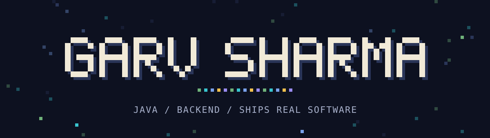

<!--
  Profile README for github.com/garvsharma663
  Put this file and the assets/ folder at the root of a PUBLIC repo named exactly "garvsharma663".
  All pixel art lives in assets/ and is generated from tiny grids of squares in the same palette as halxnao.github.io.
-->

  

  <b>I build software end to end and put it in people's hands.</b> 
  Java-first, backend-minded, with shipped Android and desktop apps behind me.

## About

I'm a developer who likes the part of software that sits under the screen: data, APIs, files moving
safely from A to B. I'm looking for a Java / backend role, and I'd rather show you running software
than a list of courses. Everything on this page is something I designed, built and released myself.

<table>
  <tr>
    <td align="center" width="25%"> <b>Java</b> Spring Boot, REST APIs</td>
    <td align="center" width="25%"> <b>SQL</b> Databases and data modelling</td>
    <td align="center" width="25%"> <b>Android</b> Apps on Google Play</td>
    <td align="center" width="25%"> <b>Desktop</b> JavaFX and command line</td>
  </tr>
</table>

Backend work is where I want to grow, so Spring Boot, REST APIs and SQL are what I'm digging into
now, alongside system-level problems like encryption, file transfer and real-time audio processing.

## Shipped

Released under my independent label **HALXNAO**, with one more on the way.

<table>
  <tr>
    <td width="72" align="center"></td>
    <td>
      <b><a href="https://halxnao.github.io/apps/beatzyy.html">Beatzyy</a></b> · Android · on Google Play 
      An offline music player with adjustable playback speed, reverb, an equalizer and customizable Now Playing scenes.
    </td>
  </tr>
  <tr>
    <td width="72" align="center"></td>
    <td>
      <b><a href="https://halxnao.github.io/apps/swiftx.html">SwiftX</a></b> · Desktop and command line 
      Encrypted file transfer between devices over a local connection, using AES-based encryption.
      Android version in testing.
    </td>
  </tr>
  <tr>
    <td width="72" align="center"></td>
    <td>
      <b><a href="https://halxnao.github.io/apps/hibiki.html">Hibiki</a></b> · Desktop, built with JavaFX 
      A player that applies Beatzyy-style audio effects in real time to video as well as music, with an audio export section.
      Releases on <a href="https://github.com/halxnao/hibiki-releases">GitHub</a>.
    </td>
  </tr>
  <tr>
    <td width="72" align="center"></td>
    <td>
      <b><a href="https://halxnao.github.io/apps/beatzyy-free.html">Beatzyy Free Edition</a></b> · Android · coming soon, in closed testing 
      A free Android player with slowed playback, nightcore and reverb, in a classic Holo-inspired interface.
    </td>
  </tr>
</table>

## Where things live

| | |
|---|---|
| **This account** | My personal developer profile: code, experiments and engineering work. |
| **[HALXNAO](https://github.com/halxnao)** | My independent software label. This is where finished apps are released and distributed. |
| **[halxnao.github.io](https://halxnao.github.io/)** | The portfolio: every app, screenshots, downloads and terms in one place. |

  <a href="https://halxnao.github.io/"><b>Portfolio</b></a>
  &nbsp;·&nbsp;
  <a href="https://github.com/halxnao"><b>HALXNAO</b></a>
  &nbsp;·&nbsp;
  <a href="https://halxnao.github.io/#contact"><b>Contact</b></a>

